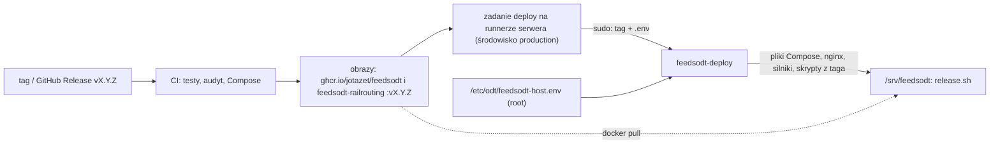

# Wdrożenie: wydania z GitHuba

Tag `vX.Y.Z` na `main` wdraża się sam na serwer ODT. Model jest ten sam co w backendzie
ODT (jego `docs/deployment.md`, sekcja 20), z tym samym runnerem na serwerze:



1. **CI** (`.github/workflows/ci.yml`) uruchamia testy i sprawdzenia na runnerach GitHuba,
   potem zadanie `obrazy` buduje obraz fetchera i silnika kolejowego i wypycha je jako
   `ghcr.io/jotazet/feedsodt:vX.Y.Z` i `ghcr.io/jotazet/feedsodt-railrouting:vX.Y.Z`
   (`main` dostaje `:main`). Zadanie `deploy` rusza tylko wtedy, gdy wszystko przeszło, na
   runnerze na serwerze (etykieta `odt-production`, użytkownik `odt-runner`), i pisze `.env`
   ze zmiennych środowiska `production` (`scripts/deploy/envfile.py`).
2. Uruchamia przez sudo `/usr/local/sbin/feedsodt-deploy` jako `feedsodt`, właściciel
   katalogu wdrożenia `/srv/feedsodt`. To jedyne polecenie, które `odt-runner` może tak
   uruchomić. `feedsodt-deploy` odmawia taga spoza `vX.Y.Z` i commitu spoza `main`, łączy
   `.env` z zadania z plikiem hosta (niżej), rozpakowuje commit taga do katalogu
   tymczasowego i uruchamia jego `release.sh`. Na serwerze nie ma checkoutu.
3. **`release.sh`** odmawia, gdy trwa przebieg fetchera (blokada `gtfs/.work/.lock`),
   dopisuje do `.env` `FEEDSODT_VERSION=vX.Y.Z` i ściąga obrazy taga (także silników, żeby
   były na miejscu przed nocą). Do tej chwili katalog wdrożenia jest nietknięty. Potem
   kopiuje pliki Compose, `nginx/`, konfigurację silników i `scripts/deploy/` obok
   (`.release-new/`) i dopiero całą kopię podmienia na miejscu, instaluje nowy `.env`,
   odtwarza `fetcher` (`up -d --wait`) i czeka do 10 minut, aż będzie zdrowy. `web`
   odtwarza tylko przy zmianie `nginx/default.conf`: montuje ten plik, więc sam by go nie
   przeczytał. Na koniec usuwa z hosta obrazy wszystkich poza 3 najnowszymi wydaniami
   (rejestr trzyma każde). Każdy błąd zatrzymuje go i zadanie robi się czerwone.

Silników routujących wydanie nie uruchamia: działają tylko w nocnym oknie
(`shaper/engines.crontab`), a ich następny start bierze już obraz nowego wydania.

**Źródła są w obrazie.** Na produkcji `config/` nie jest montowany z hosta
(`docker-compose.prod.yml`), więc tag ustala, jakie źródła, w jakich slotach i z jaką
przebudową działają. Nowe źródło albo zmiana slotu to nowe wydanie, nie edycja pliku na
serwerze.

**Po wydaniu** fetcher startuje od nowa bez przebiegu: na produkcji
`FEEDSODT_RUN_ON_START` jest domyślnie `false` (`docker-compose.prod.yml`). Pliki zostają,
a źródła idą w swoich slotach. Przy `true` fetcher od razu robiłby pełny przebieg, w dzień
bez silników routujących: źródła z `shape` zawodziłyby i ponawiały się do godziny,
a w tym czasie `release.sh` odrzucałby następne wydanie. Żeby nowe źródło dostało plik
od razu, uruchom je ręcznie:
`docker exec feedsodt-fetcher python -m feedsodt run-once --only <nazwa>`.

## Wydawanie

Scal do `main`, potem na GitHubie: *Releases -> Draft a new release -> Choose a tag ->*
nowy tag `vX.Y.Z` na `main` *-> Generate release notes -> Publish*. Albo z czystego `main`:

```bash
git tag -a v1.0.0 -m "v1.0.0" && git push origin v1.0.0
```

[Semantic Versioning](https://semver.org/): MAJOR, gdy zmienia się coś, na czym polegają
odbiorcy (adres pliku, pola `index.json`, `trip_id`), MINOR dla nowych źródeł i funkcji,
PATCH dla poprawek. Przebieg widać w *Actions*; log zadania pokazuje
`feedsodt-deploy: <stara> -> <nowa>` i `release: vX.Y.Z działa`.

**Powrót do poprzedniej wersji:** *Re-run jobs* na przebiegu starszego taga. Używa jego
workflowu, jego obrazów (3 ostatnie są jeszcze na hoście, starsze ściągnie z rejestru)
i dzisiejszych ustawień.

## Środowisko `production` na GitHubie

*Settings -> Environments -> New environment* `production`. Trzeba je założyć przed
pierwszym wydaniem: zadanie `deploy` utworzyłoby je samo, ale bez reguły poniżej.

- **Deployment branches and tags:** *Selected branches and tags*, reguła tagów `v*`.
  Wtedy żadna gałąź, pull request ani inny workflow nie dostaje jego zmiennych.
- **Environment variables** (wszystkie opcjonalne; domyślne z `docker-compose.yml` są
  produkcyjne): `FEEDSODT_INTERVAL_DAYS`, `FEEDSODT_RUN_AT`, `FEEDSODT_RETRY_MINUTES`,
  `FEEDSODT_RUN_ON_START`, `FEEDSODT_SHAPE_WORKERS`, `FEEDSODT_SHAPE_GPS_ACCURACY`
  (znaczenie: `README.md`, „Konfiguracja"). Do tego `DEPLOY_APP_USER`, użytkownik, jako
  który działa `feedsodt-deploy` (domyślnie `feedsodt`); do `.env` nie trafia.
- **Environment secrets:** dziś żadnych.

Lista dozwolonych zmiennych to `RELEASE_VARIABLES` w `scripts/deploy/envfile.py`. Serwer
odmawia wydania, zanim cokolwiek zmieni, jeśli przyjdzie inna zmienna
(`Wydanie nie może ustawić ...`). Zmienne repozytorium i organizacji są w tym samym
kontekście `vars`, więc też trafiają do `.env`: trzymaj ustawienia produkcji tylko
w środowisku. `feedsodt-deploy` bierze listę z `main`, więc nowa zmienna działa dopiero
po scaleniu.

Nowa zmienna fetchera wymaga trzech miejsc: `environment:` fetchera w `docker-compose.yml`
(`${NAZWA:-domyślna}`), `RELEASE_VARIABLES` i `.env.example`. `tests/test_deploy.py`
pilnuje pierwszych dwóch. Nowy sekret: `SECRETS` w `envfile.py` i `env:` kroku
„Zapis .env" w zadaniu `deploy`.

Do tego *Settings -> Actions -> General -> Fork pull request workflows from outside
collaborators*: **Require approval for all outside collaborators**. Pull request może
zmienić `ci.yml` i wysłać zadanie na runner serwera, więc przeczytaj zmiany workflowów
z forka, zanim zatwierdzisz przebieg.

### Rejestr obrazów

Zadanie `obrazy` wypycha tokenem samego workflowu, więc nic się dla niego nie przechowuje.
Pakiety `feedsodt` i `feedsodt-railrouting` (*profil właściciela -> Packages*) muszą być
**publiczne**, bo serwer ściąga bez logowania (obrazy mają tylko kod publicznego
repozytorium). GitHub zakłada je jako prywatne przy pierwszym pushu: po pierwszym przebiegu
na `main` *Package settings -> Change visibility -> Public*, dla obu. Sprawdzenie z dowolnej
maszyny: `docker pull ghcr.io/jotazet/feedsodt:main`.

## Plik hosta

`/etc/odt/feedsodt-host.env` trzyma to, co decyduje, co i jak działa na maszynie, i wygrywa
z `.env` zadania. Wymagane jest `COMPOSE_FILE`; poza tym porty, ścieżki i limity
(`FEEDSODT_PORT`, `FEEDSODT_OSM_FILE`, `FEEDSODT_RAIL_PORT`, `FEEDSODT_BUS_PORT`,
`RAIL_JAVA_OPTS`, `BUS_JAVA_OPTS`, `RAIL_MEM_LIMIT`, `BUS_MEM_LIMIT`, `RAIL_CPUS`,
`BUS_CPUS`; znaczenie w `.env.example`). Nie trzyma sekretów. `feedsodt-deploy` nie ruszy,
jeśli plik albo `/etc/odt` nie należą do roota albo może je zapisać ktoś inny. Format jak
`.env`, `$$` dla dosłownego `$`.

```dotenv
# Nakładka produkcyjna: obrazy z ghcr.io, źródła z obrazu. Czyta ją też shaper/engines.sh.
COMPOSE_FILE=docker-compose.yml:docker-compose.prod.yml
FEEDSODT_PORT=8090
```

Zmiana: jako root (`sudoedit /etc/odt/feedsodt-host.env`), potem wydanie albo *Re-run jobs*
ostatniego wydania.

## Konfiguracja serwera (raz)

Jako administrator (`rocky`). Pliki instalowane jako root weź z kopii repozytorium z `main`
(`scp` albo `curl` z `raw.githubusercontent.com`) i przeczytaj, zanim zainstalujesz.

```bash
# Użytkownik aplikacji: właściciel katalogu wdrożenia, uruchamia każde wydanie i silniki
# z crona. Grupa docker pozwala mu używać Compose.
sudo useradd --system --create-home --home-dir /var/lib/feedsodt --shell /sbin/nologin feedsodt
sudo usermod -aG docker feedsodt
sudo install -d -o feedsodt -g feedsodt -m 755 /srv/feedsodt

# Polecenie wdrożenia, własność roota; instaluj od nowa przy każdej zmianie
# scripts/deploy/feedsodt-deploy.
curl -fsSL -o /tmp/feedsodt-deploy \
  https://raw.githubusercontent.com/jotazet/FeedsODT/main/scripts/deploy/feedsodt-deploy
less /tmp/feedsodt-deploy
sudo install -o root -g root -m 755 /tmp/feedsodt-deploy /usr/local/sbin/feedsodt-deploy && rm /tmp/feedsodt-deploy

# Plik hosta (wyżej). /etc/odt istnieje już dla backendu ODT.
sudoedit /etc/odt/feedsodt-host.env
sudo chown root:root /etc/odt/feedsodt-host.env && sudo chmod 644 /etc/odt/feedsodt-host.env

# odt-runner może uruchomić jako feedsodt dokładnie to polecenie, nic więcej.
echo 'odt-runner ALL=(feedsodt) NOPASSWD: /usr/local/sbin/feedsodt-deploy' \
  | sudo tee /etc/sudoers.d/odt-runner-feedsodt > /dev/null
sudo chmod 440 /etc/sudoers.d/odt-runner-feedsodt && sudo visudo -cf /etc/sudoers.d/odt-runner-feedsodt
```

Runner, w osobnym katalogu, zarejestrowany do tego repozytorium (wersję, sumę kontrolną
i token rejestracji daje *Settings -> Actions -> Runners -> New self-hosted runner*).
Użytkownik `odt-runner` jest ten sam co dla backendu i frontendu ODT; etykieta
`odt-production` może się powtarzać, bo runner jednego repozytorium nie bierze zadań
innego. Runnery jednego użytkownika widzą nawzajem swoje pliki (backend ODT, „Another ODT
repository").

```bash
sudo install -d -o odt-runner -g odt-runner -m 750 /opt/actions-runner/feedsodt
curl -fsSLO https://github.com/actions/runner/releases/download/v<wersja>/actions-runner-linux-x64-<wersja>.tar.gz
echo "<sha256>  actions-runner-linux-x64-<wersja>.tar.gz" | sha256sum -c
sudo -u odt-runner tar xzf actions-runner-linux-x64-<wersja>.tar.gz -C /opt/actions-runner/feedsodt
cd /opt/actions-runner/feedsodt
sudo -u odt-runner ./config.sh --unattended --url https://github.com/jotazet/FeedsODT \
  --token <token rejestracji> --name odt-vps-feedsodt --labels odt-production --work _work
sudo ./svc.sh install odt-runner && sudo ./svc.sh start
```

Runner ma się pokazać jako *Idle* w *Settings -> Actions -> Runners*. Sprawdzenie
ograniczenia bez wdrażania:

```bash
sudo -u odt-runner sudo -n -u feedsodt /usr/local/sbin/feedsodt-deploy nope < /dev/null
# feedsodt-deploy: oczekiwano taga wydania vX.Y.Z, jest 'nope'
```

## Przeniesienie z checkoutu `/home/rocky/FeedsODT` (raz)

Do tej pory produkcja działała z checkoutu jako `rocky`. Przeniesienie zachowuje feedy,
wycinek OSM i grafy silników. Wydanie przejmuje kontenery starego stosu, więc feedy
znikają tylko na kilka sekund odtwarzania nginx-a. Rób to w dzień, gdy nie trwa przebieg (`docker logs
feedsodt-fetcher`).

1. Zmień nazwę domyślnej gałęzi `master` na `main` (*Settings -> General -> Default
   branch*), scal gałąź z wydaniami, ustaw środowisko `production` i publiczne pakiety
   (wyżej), zrób konfigurację serwera.
2. Sprawdź nazwę projektu starego stosu. Ma być `feedsodt`, bo tak nazywa projekt
   `docker-compose.prod.yml` i tylko wtedy wydanie przejmie stare kontenery:

   ```bash
   docker inspect -f '{{index .Config.Labels "com.docker.compose.project"}}' feedsodt-fetcher
   ```

   Jeśli jest inna, przed krokiem 6 zatrzymaj stary stos
   (`cd /home/rocky/FeedsODT && docker compose --profile shape down`); feedy znikną do
   końca wydania.
3. Przenieś ustawienia hosta ze starego `.env` do pliku hosta:

   ```bash
   grep -E '^(FEEDSODT_PORT|FEEDSODT_OSM_FILE|FEEDSODT_RAIL_PORT|FEEDSODT_BUS_PORT|RAIL_|BUS_)' /home/rocky/FeedsODT/.env
   ```

   Ścieżkę `FEEDSODT_OSM_FILE` wskazującą do `/home/rocky/FeedsODT` popraw na
   `/srv/feedsodt/osm/...` albo usuń (domyślna `./osm/poland-latest.osm.pbf` jest już
   w katalogu wdrożenia). Ustawienia fetchera z tego `.env` (`FEEDSODT_SHAPE_WORKERS` itd.)
   wpisz jako zmienne środowiska `production`. Dotąd i tak do fetchera nie docierały,
   bo `docker-compose.yml` miał je wpisane na sztywno.
4. Usuń dwie linie silników z crontaba `rocky` (`crontab -e`). Inaczej w nocy stary cron
   podniesie silniki ze starego katalogu.
5. Skopiuj dane (te same właściciele, `gtfs/` zostaje UID 1000):

   ```bash
   sudo rsync -a /home/rocky/FeedsODT/gtfs /home/rocky/FeedsODT/osm /srv/feedsodt/
   sudo install -d -o feedsodt -g feedsodt /srv/feedsodt/shaper
   sudo rsync -a /home/rocky/FeedsODT/shaper/cache /srv/feedsodt/shaper/
   ```

6. Wydaj `v1.0.0`. Po zielonym zadaniu zainstaluj crontab silników (przed 00:45):

   ```bash
   sudo crontab -u feedsodt /srv/feedsodt/shaper/engines.crontab
   sudo crontab -u feedsodt -l
   ```

7. Sprawdź:

   ```bash
   docker inspect -f '{{.Config.Image}} {{.State.Health.Status}}' feedsodt-fetcher
   curl -sI http://localhost:8090/gtfs/index.json
   sudo journalctl -t feedsodt-engines --since today   # rano: start 00:45 i stop 07:30
   ```

   Po kilku spokojnych nocach usuń stary checkout
   (`/home/rocky/FeedsODT`); do tego czasu jest kopią danych na wypadek powrotu.

Compose 2.24.4 lub nowszy jest wymagany (`!override`, `!reset` w `docker-compose.prod.yml`);
backend ODT ma ten sam wymóg, więc serwer go spełnia.
